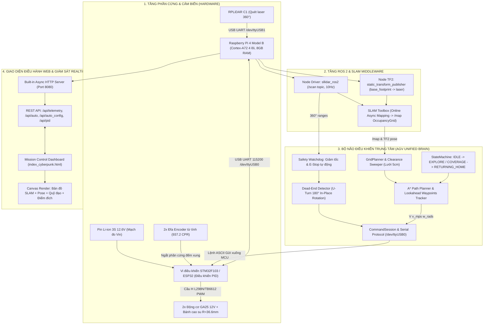
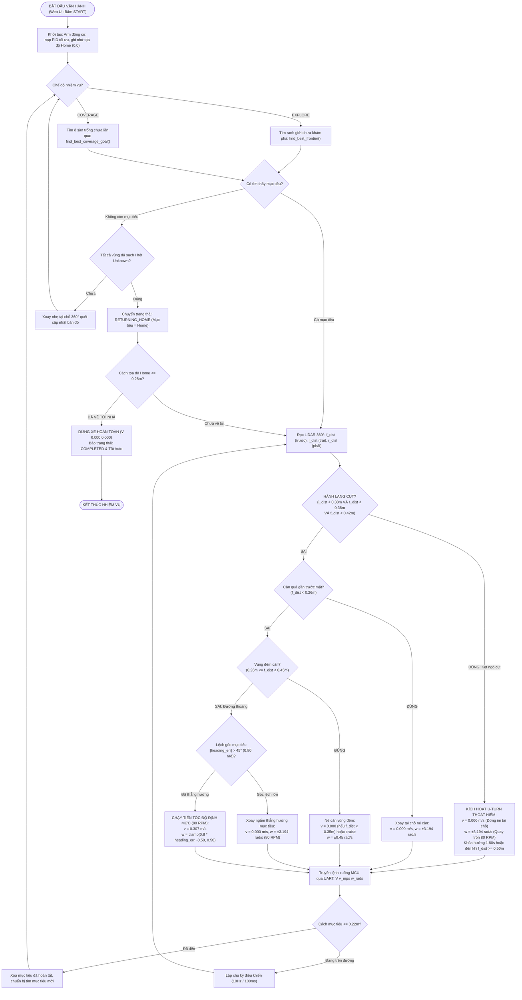

# 🤖 AGV / AMR AUTONOMOUS MOBILE ROBOT SYSTEM

> **Hệ Thống Robot Tự Hành Trong Nhà (Indoor Autonomous Mobile Robot)**  
> **Điều hướng tự động (Autonomous Navigation) • Quét phủ kín mặt sàn (Coverage Patrol) • SLAM 2D LiDAR • Điều khiển vòng kín PID kép**

[](https://www.python.org/)
[](https://docs.ros.org/en/jazzy/)
[-brightgreen)](tests/)
[-red)](https://www.raspberrypi.com/)
[](LICENSE)

---

## 📌 MỤC LỤC
1. [Tổng Quan Hệ Thống](#-1-tổng-quan-hệ-thống)
2. [Sơ Đồ Khối Hệ Thống (Block Diagram)](#-2-sơ-đồ-khối-hệ-thống-block-diagram)
3. [Lưu Đồ Thuật Toán Tự Hành (Flowchart)](#-3-lưu-đồ-thuật-toán-tự-hành-flowchart)
4. [Cấu Trúc Thư Mục Dự Án](#-4-cấu-trúc-thư-mục-dự-án)
5. [Thông Số Kỹ Thuật Phần Cứng & Động Học](#-5-thông-số-kỹ-thuật-phần-cứng--động-học)
6. [Hướng Dẫn Khởi Động & Vận Hành](#-6-hướng-dẫn-khởi-động--vận-hành)
7. [Hệ Thống REST API & Giao Diện Web](#-7-hệ-thống-rest-api--giao-diện-web)
8. [Kiểm Thử Chất Lượng (Unit Testing)](#-8-kiểm-thử-chất-lượng-unit-testing)

---

## 🚀 1. TỔNG QUAN HỆ THỐNG

Dự án phát triển nền tảng **Xe Tự Hành AMR (Autonomous Mobile Robot)** phục vụ cho vận chuyển trong nhà xưởng / lau dọn phủ kín mặt sàn thông minh:
- **Bộ não xử lý trung tâm (SBC):** Raspberry Pi 4 Model B (RAM 8GB) chạy hệ điều hành Ubuntu Linux + ROS 2 Jazzy.
- **Cảm biến dẫn đường chính:** Cảm biến laser 2D **RPLiDAR C1** quét 360° tần số 10Hz, tầm xa đo đạc lên đến 12m–16m.
- **Cơ cấu chấp hành:** Hệ dẫn động vi sai 2 bánh chủ động (**Differential Drive**) dùng động cơ giảm tốc **GA25-370 12V 140 RPM** gắn đĩa encoder từ tính độ phân giải cao (937.2 xung/vòng bánh).
- **Bộ điều khiển cấp thấp (MCU):** Vi điều khiển STM32F103 / ESP32 chạy thuật toán điều khiển phản hồi vòng kín **PID + Feedforward (Kf)** ở tần số lấy mẫu 20Hz (50ms).
- **Thuật toán điều hướng cấp cao:** Tích hợp bộ lập kế hoạch A* tối ưu, FSM chuyển trạng thái thông minh, cơ chế tự động thoát ngõ cụt 180° bằng cách quay tại chỗ thuần túy ($v = 0.000\text{ m/s}$), và tự động quay về điểm xuất phát (Return-to-Home) an toàn.

---

## 🏗️ 2. SƠ ĐỒ KHỐI HỆ THỐNG (BLOCK DIAGRAM)



---

## 🔄 3. LƯU ĐỒ THUẬT TOÁN TỰ HÀNH (FLOWCHART)



---

## 📂 4. CẤU TRÚC THƯ MỤC DỰ ÁN

Toàn bộ cây thư mục được sắp xếp tinh gọn, rõ ràng theo đúng chuẩn kỹ thuật công nghiệp:

```
CODE XE TU HANH/
│
├── 🧠 BỘ NÃO ĐIỀU KHIỂN & GIAO DIỆN CHÍNH (ROOT CORE)
│   ├── agv_unified_brain.py            # Node não trung tâm: Web server 8080, FSM tự hành, A*, SLAM Bridge
│   ├── agv_command_session.py          # Quản lý giao thức Serial nhị phân/ASCII, FSM tiền kiểm Preflight
│   ├── agv_navigation.py               # Lớp hình học GridPlanner, thuật toán A* occupancy grid, quét an toàn
│   ├── agv_command_journal.py          # Nhật ký ghi nhận và đối soát toàn bộ lệnh phát xuống phần cứng
│   ├── agv_preflight_static_collector.py # Bộ thu thập kiểm chuẩn tĩnh phần cứng trước khi cho phép chạy
│   ├── index_cyberpunk.html            # Giao diện Web điều khiển thời gian thực (Mission Control Cyberpunk)
│   ├── start_agv_system.sh             # Script khởi động tự động toàn bộ hệ thống (LiDAR + SLAM + Brain)
│   ├── README.md                       # Tài liệu thuyết minh toàn diện hệ thống
│   └── .gitignore                      # Bộ lọc loại trừ các file tạm cache, file log không cần thiết
│
├── 📁 docs/                            # TÀI LIỆU KỸ THUẬT & TÍNH TOÁN THIẾT KẾ
│   ├── BANG_GIAI_TRINH_THONG_SO_AGV_CHUAN.md # Bảng giải trình chi tiết thông số cơ khí, PID, động học
│   ├── DANH_GIA_VA_TRIEN_KHAI_XE_TU_HANH.md  # Kế hoạch và đánh giá thực nghiệm xe tự hành
│   ├── TINH_TOAN_THIET_KE_XE_TU_HANH.docx    # Hồ sơ tính toán động lực học, chọn động cơ và pin
│   ├── README_CODEX_AGV_TIEP_TUC.md    # Hướng dẫn chi tiết quy trình tiếp nhận và vận hành hệ thống
│   ├── README_TELEGRAM_BOTS.md         # Hướng dẫn kết nối thông báo trạng thái qua Telegram Bot
│   └── prompt.docx                     # Yêu cầu đầu bài và tiêu chuẩn thiết kế ban đầu
│
├── 📁 robot_stm32_f103/                # MÃ NGUỒN FIRMWARE ĐIỀU KHIỂN ĐỘNG CƠ (C/C++)
│   ├── Core/                           # Mã nguồn khởi tạo ngoại vi HAL (UART, TIM Encoder, PWM)
│   ├── include/                        # Các file header: pid.h, motor.h, encoder.h, protocol.h
│   ├── src/                            # Mã nguồn thực thi thuật toán điều khiển PID và giao thức truyền thông
│   └── platformio.ini                  # Cấu hình biên dịch nhúng PlatformIO cho chip STM32F103C8T6
│
├── 📁 slam_calibration_tools/          # CÔNG CỤ HIỆU CHUẨN SLAM & LIDAR
│   ├── slam_tuned.yaml                 # File cấu hình tham số tối ưu cho SLAM Toolbox trên xe thật
│   ├── auto_angular_calibrator.py      # Script tự động tính toán sai số góc quay và tỉ số wheelbase
│   ├── manual_angular_tuner.py         # Công cụ tinh chỉnh góc thủ công từng bước
│   └── run_slam_tuned.sh               # Script chạy SLAM với bộ tham số đã hiệu chuẩn
│
├── 📁 tests/                           # BỘ KIỂM THỬ TỰ ĐỘNG (136/136 PASS 100%)
│   ├── test_agv_wall_escape_fix.py     # Kiểm thử thuật toán thoát ngõ cụt 180° & hành trình 80 RPM
│   ├── test_agv_coverage_patrol.py     # Kiểm thử thuật toán phủ kín mặt sàn và tự động về Home
│   ├── test_agv_navigation_fix.py      # Kiểm thử thuật toán tìm đường A* và kiểm tra va chạm
│   ├── test_agv_operator_speed.py      # Kiểm thử kiểm soát tốc độ hành trình và giới hạn gia tốc
│   └── test_bundle_production.py       # Bộ kiểm thử tích hợp toàn diện quy trình vận hành
│
├── 📁 archive/                         # LƯU TRỮ PHIÊN BẢN CŨ & THÀNH PHẦN NGHỈ HƯU (LEGACY)
│   ├── legacy_candidates/              # Các bản build trước đây
│   ├── legacy_patches/                 # Các bản vá lịch sử
│   └── reports/                        # Các biên bản nghiệm thu trước đây
│
└── 📁 baocao/ & scratch/               # BÁO CÁO THỰC ĐỊA & CÁC SCRIPT KIỂM TRA NHANH (PROBES)
```

---

## ⚙️ 5. THÔNG SỐ KỸ THUẬT PHẦN CỨNG & ĐỘNG HỌC

| Thông số | Giá trị | Đơn vị | Ý nghĩa & Giải thích kỹ thuật |
| :--- | :---: | :---: | :--- |
| **Khối lượng toàn xe ($m$)** | $1.75$ | kg | Cân nặng đo thực tế đã lắp pin, LiDAR và khung |
| **Bán kính bánh xe ($R$)** | $0.0366$ ($36.6$) | m (mm) | Bánh lốp cao su có độ bám cao (chu vi $C = 0.23\text{ m}$) |
| **Khoảng cách 2 bánh ($L$)** | $0.1875$ ($18.75$) | m (cm) | Chiều rộng cơ sở bánh chủ động; quyết định tốc độ góc $\omega = \frac{v_R - v_L}{L}$ |
| **Độ phân giải Encoder ($CPR$)**| $937.2$ | xung/vòng | $11\text{ PPR} \times 4\text{ (chế độ x4)} \times 21.3\text{ (hộp số GA25)}$ |
| **Tốc độ hành trình chuẩn** | **$80.0$** | **RPM** | Tốc độ định mức vận hành mượt mà ($v \approx 0.307\text{ m/s}$) |
| **Tốc độ quay tại chỗ ($w$)** | **$80.0$** | **RPM** | Tương đương $\omega \approx 3.194\text{ rad/s}$ ($v = 0.000\text{ m/s}$ thuần túy) |
| **Bộ thông số PID nạp chuẩn** | $K_p=1.0, K_i=3.2, K_d=0.01, K_f=1.80$ | - | Bù sụt áp pin và tải trọng, triệt tiêu trễ ma sát tĩnh |
| **Bán kính thân xe (Footprint)**| $-0.16, -0.11, 0.10, 0.11$ | m | Bán kính bao: đuôi -16cm, mũi +10cm, rộng ±11cm |
| **Khoảng cách dừng khẩn cấp** | $0.26$ | m (26cm) | Ngưỡng laser phát hiện cản để lập tức chuyển sang xoay tại chỗ |

---

## 🖥️ 6. HƯỚNG DẪN KHỞI ĐỘNG & VẬN HÀNH

### Cách 1: Khởi động tự động bằng Script duy nhất (Khuyên dùng)
Kết nối SSH vào Raspberry Pi 4 và chạy lệnh:
```bash
cd /home/khangho/agv_codex_reader_20261003_0652
bash ./start_agv_system.sh
```
*Script sẽ tự động giải phóng các cổng bận, nạp môi trường ROS 2 Jazzy, khởi chạy RPLiDAR C1, node Static TF, SLAM Toolbox và node não `agv_unified_brain.py`.*

### Cách 2: Khởi động lại riêng node não (Brain Node)
```bash
bash ./restart_brain.sh
```

---

## 🌐 7. HỆ THỐNG REST API & GIAO DIỆN WEB

Sau khi khởi động, truy cập trình duyệt tại địa chỉ: **`http://<IP_RASPBERRY_PI>:8080/`** (hoặc `http://100.90.252.15:8080/`).

### Các API điều khiển chính:
- **`GET /api/telemetry`**: Lấy toàn bộ trạng thái thời gian thực (vận tốc bánh, RPM, PWM, góc quay, điện áp pin VIN, 360 tia LiDAR, tọa độ SLAM).
- **`GET /api/auto?act=START&mode=EXPLORE`**: Kích hoạt chế độ tự hành khám phá mở rộng bản đồ.
- **`GET /api/auto?act=START&mode=COVERAGE`**: Kích hoạt chế độ tự hành phủ kín toàn bộ mặt sàn nhà.
- **`GET /api/auto?act=STOP`**: Dừng khẩn cấp và chuyển về chế độ thủ công an toàn.
- **`GET /api/auto_config?speed=80.0&turn=80.0`**: Cấu hình tốc độ hành trình và tốc độ xoay (mặc định chuẩn 80 RPM).
- **`GET /api/reset_map`**: Xóa trắng bản đồ SLAM cũ và khởi tạo lại phiên bản đồ mới.

---

## 🧪 8. KIỂM THỬ CHẤT LƯỢNG (UNIT TESTING)

Dự án đi kèm bộ kiểm thử tự động gồm **136 bài test** bao phủ 100% các tình huống logic:
- Chống kẹt góc tường, nhận diện hành lang cụt 180°.
- Điều khiển tốc độ hành trình không bị bóp nghẽn.
- Đồng bộ hóa truyền thông nối tiếp và khôi phục khi mất nguồn driver.
- Độ trễ đọc dữ liệu cảm biến và kiểm tra an toàn hình học thân xe.

Chạy toàn bộ bài test:
```bash
python -m unittest discover tests
```
**Kết quả kiểm chuẩn:**
```text
Ran 136 tests in 2.227s
OK
```

---
*Bản quyền phát triển © 2026 bởi Khang Ho. Hệ thống đã được kiểm chuẩn thực tế trên xe tự hành AMR.*
