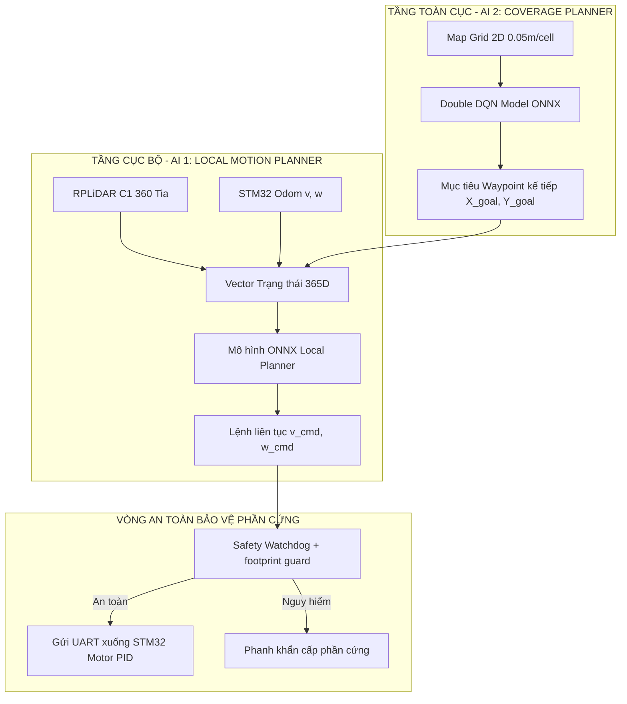

# AI 1 Local Motion Planner — nghiên cứu, mô phỏng và kiểm định

> **Mã nguồn đã triển khai:** `environments/agv_motion_env.py`, `environments/scenarios.py`,
> `models/actor_critic.py`, `trainers/ppo_agent.py`, `trainers/rollout_buffer.py`,
> `scripts/run_train.py`, `scripts/evaluate_policy.py`, `scripts/export_onnx.py`,
> `scripts/benchmark_latency.py`, và `runtime.py`.
>
> **Hướng dẫn chạy và số liệu kiểm chứng mới nhất:** [IMPLEMENTATION.md](IMPLEMENTATION.md).
> Bản thử nghiệm sáu cấp: `exported/locked_scene_margin070_experimental/package.json`.
> Đây là **ensemble PPO (Level 1–2) + BC (Level 3, 5) + LiDAR gap (Level 4, 6)**,
> có bộ phân loại cảnh ONNX và giám sát trạng thái bằng Python. Nó **không phải**
> một policy PPO duy nhất, chưa chứng minh suy luận dưới 2 ms trên Raspberry Pi 4
> và **chưa được phép điều khiển xe thật**. Bên dưới là bản đồ cấu trúc dự án;
> khi có khác biệt, dùng contract và kết quả trong `IMPLEMENTATION.md`.

---

# TRÍCH DẪN & MỤC LỤC HỆ THỐNG THƯ MỤC: AI 1 - LOCAL MOTION PLANNER (PPO)

Tài liệu này đóng vai trò là **Bản đồ chỉ dẫn (Directory Citation & Index Map)** cho toàn bộ mô-đun Huấn luyện và Triển khai **AI 1: Local Motion Planner & Reactive Obstacle Avoidance** của xe tự hành AGV (Differential Drive, RPLiDAR C1, STM32, Raspberry Pi 4).

---

## 1. CÂY THƯ MỤC TỔNG THỂ (DIRECTORY TREE)

```text
ai_local_planner/
├── README.md                      # [BẢN ĐỒ CHỈ DẪN NÀY] Trích dẫn vai trò từng thư mục con & luồng dữ liệu
├── PROMPT_TRAIN_AI1_PPO.md        # [PROMPT TIÊU CHUẨN] Prompt chi tiết nạp cho Agent / Kaggle / Cloud GPU
├── configs/                       # [THƯ MỤC CON] Lưu cấu hình siêu tham số, vật lý xe, Domain Randomization
│   ├── default_config.yaml        # Cấu hình PPO, môi trường, reward weights và Sim-to-Real
│   └── __init__.py
├── environments/                  # [THƯ MỤC CON] Môi trường mô phỏng Kinematics, LiDAR 360 & 6 kịch bản
│   ├── agv_motion_env.py          # Differential Drive Kinematics + 360 Raycasting LiDAR + Sim2Real noise
│   ├── scenarios.py               # Trình sinh 6 kịch bản huấn luyện theo cấp độ (Curriculum Learning)
│   └── __init__.py
├── models/                        # [THƯ MỤC CON] Kiến trúc mạng nơ-ron Actor-Critic
│   ├── actor_critic.py            # Continuous Gaussian Policy Actor & Critic (MLP / 1D Conv)
│   └── __init__.py
├── trainers/                      # [THƯ MỤC CON] Thuật toán huấn luyện PPO & bộ đệm kinh nghiệm
│   ├── ppo_agent.py               # Lõi PPO: PPO clipped surrogate objective, GAE, value loss, entropy bonus
│   ├── rollout_buffer.py          # Bộ đệm lưu trữ trajectory (s, a, r, v, logp, done)
│   └── __init__.py
├── checkpoints/                   # [THƯ MỤC CON] Lưu trữ trọng số mô hình PyTorch trong quá trình train
│   ├── .gitkeep
│   └── README.md                  # Hướng dẫn quản lý checkpoints, lưu best_model.pth và checkpoint_step_N.pth
├── exported/                      # [THƯ MỤC CON] ONNX và manifest; chưa nghiệm thu Pi 4/AGV
│   ├── .gitkeep
│   ├── manifest_template.json     # Metadata mẫu: input/output tensor signature, checksum, author
│   └── README.md                  # Hướng dẫn deploy ONNX sang Raspberry Pi 4 & agv_unified_brain.py
├── logs/                          # [THƯ MỤC CON] Lưu nhật ký huấn luyện, TensorBoard, đồ thị reward
│   ├── .gitkeep
│   └── README.md                  # Chỉ dẫn xem TensorBoard và phân tích log CSV
├── scripts/                       # [THƯ MỤC CON] Các kịch bản thực thi tự động (Train, Test, Export, Benchmark)
│   ├── run_train.py               # Entrypoint huấn luyện PPO cục bộ (PC / GPU)
│   ├── export_onnx.py             # Script trích xuất và tối ưu hóa ONNX Runtime (CPU latency < 2ms)
│   ├── benchmark_latency.py       # Script kiểm tra độ trễ suy luận trên Raspberry Pi 4 CPU
│   └── run_train_kaggle.sh        # Script 1-click chạy tự động trên Kaggle GPU kèm domain randomization
└── tests/                         # [THƯ MỤC CON] Kiểm thử đơn vị (Unit Tests) toán học & tensor shapes
    ├── test_motion_env.py         # Kiểm tra tính toán vật lý, raycasting LiDAR, va chạm
    ├── test_actor_critic.py       # Kiểm tra forward pass, tensor shapes, log_prob, ONNX trace sanity
    └── __init__.py
```

---

## 2. TRÍCH DẪN CHI TIẾT CÁC THƯ MỤC CON (SUBFOLDER CITATIONS)

### 2.1. Thư mục `configs/`
- **Mục đích**: Chứa toàn bộ thông số kỹ thuật tập trung. Tách biệt hoàn toàn code logic và siêu tham số, giúp dễ dàng tinh chỉnh mà không cần sửa code.
- **Tập tin chính**:
  - `default_config.yaml`:
    - **Physical params**: Bán kính xe $R=0.20\text{ m}$, khoảng cách 2 bánh $L=0.28\text{ m}$, $v_{max}=0.35\text{ m/s}$, $\omega_{max}=1.5\text{ rad/s}$, gia tốc tối đa $a_{max}=0.5\text{ m/s}^2$.
    - **LiDAR specs**: Tầm quét $0.12\text{ m} \to 12.0\text{ m}$, góc 360°, độ phân giải $1^\circ$ (360 tia).
    - **Sim-to-Real Domain Randomization**: Nhiễu LiDAR Gaussian $\sigma=3\text{cm} \to 5\text{cm}$, dropout $5\%$, trễ UART **100 ms (1 bước)**, sai lệch độ bám bánh xe $\pm 5-10\%$.
    - **PPO params**: Learning rate $3 \times 10^{-4}$, $\gamma=0.99$, $\lambda=0.95$, clip range $\epsilon=0.2$, entropy coef $0.01$.

### 2.2. Thư mục `environments/`
- **Mục đích**: Mô phỏng tương tác vật lý 2D giữa robot và môi trường dựa trên kinematic vi sai (Differential Drive) và cảm biến LiDAR C1.
- **Tập tin chính**:
  - `agv_motion_env.py`: Môi trường kế thừa Gym/Gymnasium. Tính toán chính xác vị trí robot $(x, y, \theta)$, raycasting 360 tia giao với các đoạn thẳng (tường) và hình tròn (vật cản).
    - **Observation (365 chiều)**:
      - 360 tia khoảng cách LiDAR chuẩn hóa $[0, 1]$.
      - 1 giá trị khoảng cách tới đích: $\min(d_{goal} / 10.0, 1.0)$.
      - 2 giá trị góc lệch hướng tới đích: $[\sin(\Delta\theta), \cos(\Delta\theta)]$.
      - 2 giá trị vận tốc thực tại: $[v / v_{max}, \omega / \omega_{max}]$.
    - **Action (2 chiều)**: Continuous $[v, \omega]$.
  - `scenarios.py`: Trình sinh 6 kịch bản học tăng dần (Curriculum):
    1. *Hành lang thông thoáng (Clear Corridor)*: Luyện đi thẳng nhanh và ổn định.
    2. *Vật cản tĩnh đơn lẻ (Single Obstacle)*: Luyện cua mềm lách vật cản.
    3. *Hẻm hẹp & Góc vuông 90° (Narrow Passage & Corner)*: Luyện bám tâm đường, không quẹt thân.
    4. *Khu vực nhiều chướng ngại vật (Cluttered Slalom)*: Luyện luồn lách slalom liên tục.
    5. *Bẫy túi chữ U (U-Pocket Trap)*: Quay tại chỗ để thoát ngõ cụt; contract `v >= 0` **không cho phép lùi**.
    6. *Vật cản động (Dynamic Obstacle)*: Luyện tránh người/vật cắt ngang đường.

### 2.3. Thư mục `models/`
- **Mục đích**: Định nghĩa cấu trúc mạng nơ-ron học sâu (PyTorch) cho chính sách chuyển động liên tục.
- **Tập tin chính**:
  - `actor_critic.py`:
    - **Backbone**: Feature Extractor kết hợp 1D Convolution (xử lý 360 tia LiDAR tuần hoàn) + MLP (xử lý vector mục tiêu & vận tốc).
    - **Actor Head**: Xuất ra Mean $\mu(v, \omega)$ và Log-Std $\log\sigma(v, \omega)$ (Continuous Gaussian Distribution) kèm hàm bóp Squashed Tanh / Beta Distribution đảm bảo hành vi trong phạm vi an toàn.
    - **Critic Head**: Xuất ra giá trị trạng thái $V(s)$.

### 2.4. Thư mục `trainers/`
- **Mục đích**: Triển khai thuật toán PPO (Proximal Policy Optimization).
- **Tập tin chính**:
  - `ppo_agent.py`: Cập nhật mạng Actor & Critic qua hàm mất mát PPO-clip:
    $$L^{CLIP}(\theta) = \hat{\mathbb{E}}_t \left[ \min\left( r_t(\theta)\hat{A}_t, \text{clip}(r_t(\theta), 1-\epsilon, 1+\epsilon)\hat{A}_t \right) \right]$$
    Kèm Generalized Advantage Estimation (GAE) và điều chỉnh entropy để duy trì tính khám phá.
  - `rollout_buffer.py`: Quản lý bộ nhớ batch trajectories, tính toán Advantages và Returns chuẩn hóa.

### 2.5. Thư mục `checkpoints/`
- **Mục đích**: Nơi tự động lưu các file trọng số `.pth` trong quá trình chạy.
- **Quy tắc**:
  - `best_model.pth`: Checkpoint có điểm trung bình (Reward & Success Rate) cao nhất.
  - `checkpoint_epoch_xxxx.pth`: Lưu định kỳ mỗi 500,000 bước để phòng sự cố crash / timeout Kaggle.

### 2.6. Thư mục `exported/`
- **Mục đích**: Lưu các bản ONNX đã export và checkpoint thử nghiệm phục vụ kiểm định trước khi chạy Raspberry Pi 4.
- **Tập tin chính**:
  - `local_planner.onnx`: File ONNX của checkpoint PPO Level 2; benchmark hiện có đo trên **Windows**, không xác nhận p99 Pi 4 hoặc INT8.
  - `locked_scene_margin070_experimental/package.json`: Manifest và sáu file ONNX thử nghiệm; suy luận cần supervisor `models/locked_scene_onnx_agent.py` để phân loại cảnh rồi khóa nhánh.
  - `manifest.json`: Chứa hash sha256, ngày huấn luyện, tỷ lệ thành công, quy cách tensor input/output để script chính `agv_unified_brain.py` xác thực tính toàn vẹn trước khi nạp vào xe thật.

### 2.7. Thư mục `logs/`
- **Mục đích**: Lưu trữ log thời gian thực, TensorBoard events và file CSV tổng hợp để vẽ biểu đồ và phân tích hội tụ.

### 2.8. Thư mục `scripts/`
- **Mục đích**: Chứa các tập lệnh thực thi đầu cuối (End-to-end tooling):
  - `run_train.py`: Khởi động huấn luyện trên máy tính cá nhân.
  - `run_train_kaggle.sh`: Kịch bản nén và chạy tự động trên Kaggle T4 GPU.
  - `export_onnx.py`: Trích xuất mô hình từ PyTorch checkpoint sang ONNX, kiểm tra sai số số học sai phân $< 10^{-5}$.
  - `benchmark_latency.py`: Đo đạc số micro-giây mỗi lần suy luận trên CPU.

### 2.9. Thư mục `tests/`
- **Mục đích**: Đảm bảo chất lượng phần mềm (CI/CD Quality Gate), chạy 100% tự động bằng `pytest`.
- **Nội dung kiểm tra**:
  - Kinematics Differential Drive không bị NaN/Inf.
  - 360 tia LiDAR luôn trả về khoảng cách chính xác trong đoạn $[0.12, 12.0]\text{ m}$.
  - Mạng Actor-Critic nhận đúng kích thước `(B, 365)` và trả về action `(B, 2)`.
  - ONNX Runtime cho ra cùng kết quả với PyTorch gốc.

---

## 3. LUỒNG TƯƠNG TÁC GIỮA AI 1 VÀ HỆ THỐNG AGV HIỆN TẠI



---

## 4. BẢNG THAM CHIẾU VỚI CÁC THƯ MỤC KHÁC TRONG DỰ ÁN

| Thư mục gốc dự án | Mối liên hệ với `ai_local_planner/` |
|---|---|
| `models/` | Nơi lưu mô hình AI 2 `coverage_model.onnx`. Khi hoàn tất, `exported/local_planner.onnx` sẽ được liên kết vào đây. |
| `RESULT/` | Lưu kết quả nghiệm thu của AI 2. Tương tự, `ai_local_planner/exported/` lưu kết quả AI 1. |
| `agv_unified_brain.py` | Não bộ tích hợp trên Pi 4. Sẽ gọi trực tiếp `local_planner.onnx` từ thư mục này. |
| `docs/` | Chứa các báo cáo thiết kế phần cứng xe, thông số động cơ và các tài liệu liên quan. |
