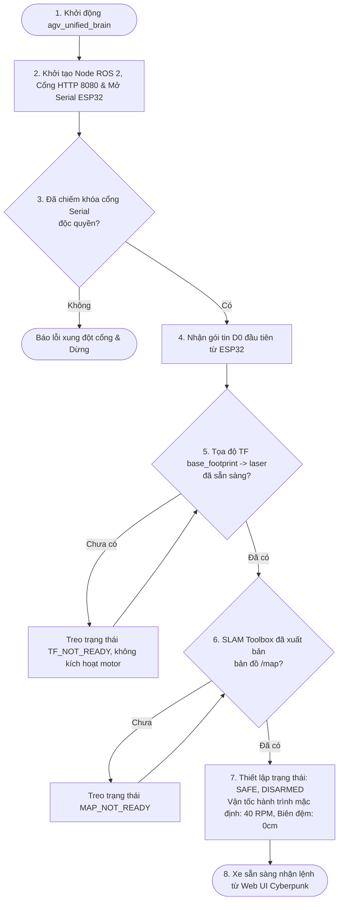
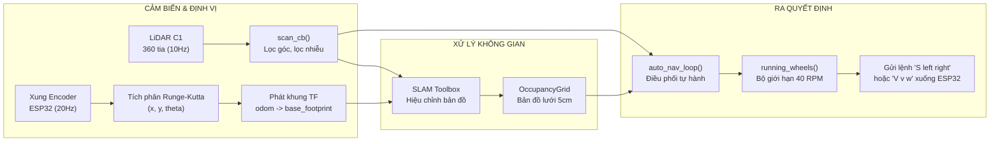
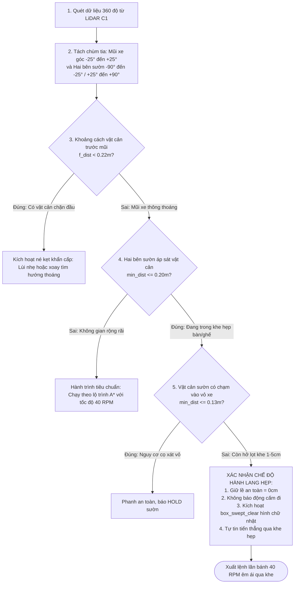
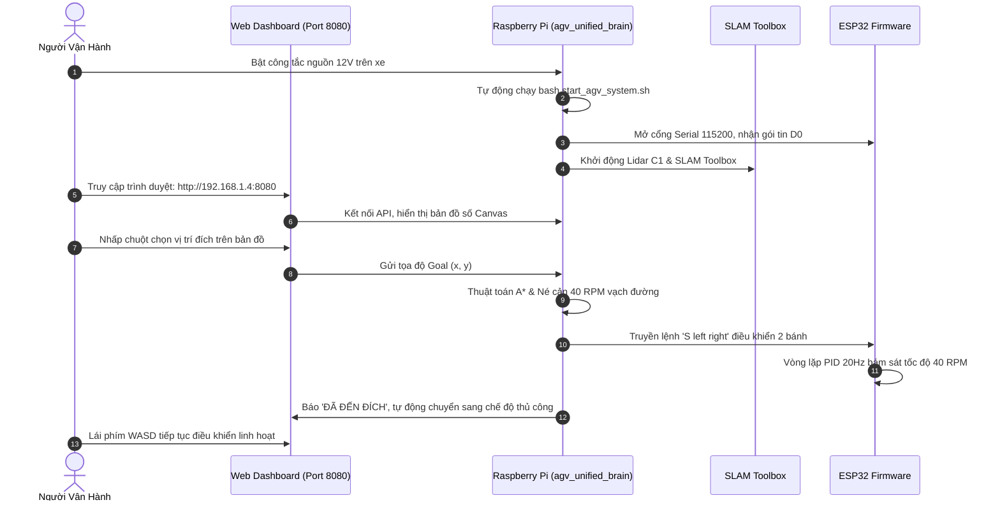

# BÁO CÁO TOÀN DIỆN THIẾT KẾ HỆ THỐNG, SƠ ĐỒ ĐẤU DÂY, LƯU ĐỒ THUẬT TOÁN VÀ QUY TRÌNH VẬN HÀNH ROBOT TỰ HÀNH AGV / AMR

> **Dự án:** Robot Tự Hành AGV / AMR - SLAM Navigation, RPLIDAR C1 & ESP32 Closed-loop Motor Control  
> **Nền tảng:** ROS 2 Jazzy (Ubuntu 24.04 trên Raspberry Pi) + FreeRTOS/Arduino trên ESP32  
> **Kho lưu trữ GitHub:** [khangho2611/AMR-backup](https://github.com/khangho2611/AMR-backup)  
> **Tài liệu tham chiếu:** Hệ thống điều phối hợp nhất `agv_unified_brain.py`, tầng phiên lệnh `agv_command_session.py`, thuật toán dẫn đường `agv_navigation.py`

---

## MỤC LỤC
1. [Tổng Quan Kiến Trúc Hệ Thống 3 Tầng](#1-tổng-quan-kiến-trúc-hệ-thống-3-tầng)
2. [Sơ Đồ Đấu Nối Dây & Sơ Đồ Khối Phần Cứng (Hardware Wiring & Pinout)](#2-sơ-đồ-đấu-nối-dây--sơ-đồ-khối-phần-cứng-hardware-wiring--pinout)
3. [Lưu Đồ Thuật Toán & Luồng Xử Lý Điều Khiển (Algorithm Flowcharts)](#3-lưu-đồ-thuật-toán--luồng-xử-lý-điều-khiển-algorithm-flowcharts)
   - [3.1. Lưu đồ khởi động & Kiểm chuẩn an toàn (Preflight Gate)](#31-lưu-đồ-khởi-động--kiểm-chuẩn-an-toàn-preflight-gate)
   - [3.2. Lưu đồ luồng dữ liệu thời gian thực (Data Pipeline)](#32-lưu-đồ-luồng-dữ-liệu-thời-gian-thực-data-pipeline)
   - [3.3. Lưu đồ điều hướng hành lang & Né vật cản thông minh (Corridor & Obstacle Avoidance)](#33-lưu-đồ-điều-hướng-hành-lang--né-vật-cản-thông-minh-corridor--obstacle-avoidance)
4. [Mô Hình Động Học & Giải Thuật Điều Khiển Vòng Kín PID](#4-mô-hình-động-học--giải-thuật-điều-khiển-vòng-kín-pid)
5. [Hướng Dẫn Quy Trình Vận Hành Xe Thực Tế (User Operation Manual)](#5-hướng-dẫn-quy-trình-vận-hành-xe-thực-tế-user-operation-manual)
6. [Bảng Tra Cứu Thông Số Kỹ Thuật Chuẩn Hóa](#6-bảng-tra-cứu-thông-số-kỹ-thuật-chuẩn-hóa)

---

## 1. TỔNG QUAN KIẾN TRÚC HỆ THỐNG 3 TẦNG

Hệ thống xe tự hành AGV được xây dựng theo mô hình phân tầng module hóa, tách bạch rõ ràng giữa tầng tính toán nhận thức cấp cao (High-level Cognition) và tầng điều khiển chấp hành cấp thấp (Low-level Control):

```mermaid
graph TB
    subgraph TANG_1["TẦNG 1: GIAO DIỆN & GIÁM SÁT NGƯỜI DÙNG (WEB UI)"]
        UI["Web Cyberpunk UI (Port 8080)<br/>HTML5 Canvas + WebSocket/Fetch HTTP API"]
        CONTROL_PAD["Bàn phím Lái tay WASD<br/>D-pad 8 hướng + E-Stop"]
        CONFIG_PANEL["Cấu hình Tốc độ (40/65 RPM)<br/>Chỉnh định PID (Kp, Ki, Kd, Kf)"]
    end

    subgraph TANG_2["TẦNG 2: BỘ NÃO ĐIỀU PHỐI TRUNG TÂM (RASPBERRY PI - ROS 2 JAZZY)"]
        BRAIN["agv_unified_brain.py<br/>Node ROS 2 điều phối chính"]
        SLAM["SLAM Toolbox Online Async<br/>Quét bản đồ OccupancyGrid 0.05m"]
        ASTAR["GridPlanner (A* Search)<br/>Định tuyến hành lang toàn cục"]
        AI_PLANNER["AI Local Planner (ONNX DRL)<br/>Né cản thời gian thực"]
        SAFETY_GATE["Bộ lọc An toàn Hành lang<br/>Corridor Logic (30° Front vs Flank)"]
    end

    subgraph TANG_3["TẦNG 3: CHẤP HÀNH & CẢM BIẾN PHẦN CỨNG (EMBEDDED HARDWARE)"]
        LIDAR["RPLIDAR C1 (360° Laser)<br/>Baud 460800, Tần số 10Hz"]
        ESP32["Vi điều khiển ESP32 (FreeRTOS)<br/>PID 20Hz, Odometry Runge-Kutta"]
        DRIVER["MKE-M18 Dual Motor Driver<br/>Giao tiếp I2C Wire (GPIO 21, 22)"]
        MOTORS["2 Động cơ GA25-370 (12V)<br/>Hộp số 21.3:1 + Hall Encoders"]
        IMU["GY-521 MPU6050 (6-DOF IMU)<br/>I2C Wire1 (GPIO 16, 17)"]
    end

    UI <==>|HTTP GET /api/telemetry (10Hz)<br/>POST /api/command (WASD)| BRAIN
    LIDAR ==>|Serial USB /dev/ttyUSB1 (460800)| BRAIN
    BRAIN <==>|Serial USB /dev/ttyUSB0 (115200)<br/>D0 Telemetry / V, S Commands| ESP32
    BRAIN --> SLAM
    SLAM --> ASTAR
    ASTAR --> SAFETY_GATE
    SAFETY_GATE --> BRAIN

    ESP32 <==>|I2C 100kHz| DRIVER
    DRIVER ==>|PWM 12V| MOTORS
    MOTORS ==>|Kênh A/B Xung Encoder| ESP32
    IMU ==>|I2C 400kHz Fast| ESP32
```

---

## 2. SƠ ĐỒ ĐẤU NỐI DÂY & SƠ ĐỒ KHỐI PHẦN CỨNG (HARDWARE WIRING & PINOUT)

### 2.1. Bảng sơ đồ chân vi điều khiển ESP32

Vi điều khiển ESP32 đóng vai trò bộ điều khiển cấp thấp, tiếp nhận chuỗi ký tự điều khiển qua cổng USB-UART (CH340), đọc xung Encoder bằng bộ đếm phần cứng chuyên dụng (PCNT) và xuất lực kéo qua giao tiếp I2C.

| Thiết bị ngoại vi | Chân ESP32 (GPIO) | Chức năng tín hiệu | Ghi chú kỹ thuật |
| :--- | :--- | :--- | :--- |
| **Driver MKE-M18** | **GPIO 21** | I2C_SDA (Bus 0) | Điều khiển tốc độ và chiều quay Motor A & B |
| **Driver MKE-M18** | **GPIO 22** | I2C_SCL (Bus 0) | Tần số xung clock I2C: 100 kHz |
| **Encoder Bánh Trái** | **GPIO 18** | ENCODER_L_A (PULSE) | Kênh A động cơ trái, đếm bằng PCNT Unit 0 |
| **Encoder Bánh Trái** | **GPIO 19** | ENCODER_L_B (CTRL) | Kênh B động cơ trái, xác định chiều quay (Up/Down) |
| **Encoder Bánh Phải** | **GPIO 25** | ENCODER_R_A (PULSE) | Kênh A động cơ phải, đếm bằng PCNT Unit 1 |
| **Encoder Bánh Phải** | **GPIO 26** | ENCODER_R_B (CTRL) | Kênh B động cơ phải, xác định chiều quay (Up/Down) |
| **Cảm biến IMU MPU6050** | **GPIO 16** | MPU_SDA (Wire1) | Kênh I2C độc lập thứ hai chống xung đột |
| **Cảm biến IMU MPU6050** | **GPIO 17** | MPU_SCL (Wire1) | Tốc độ truyền 400 kHz Fast Mode |
| **Cổng nạp & Telemetry** | **USB (GPIO 1/3)** | UART0 (TX0 / RX0) | Nối sang Raspberry Pi, Baudrate 115200 |
| **Nguồn cấp Logic** | **5V & GND** | Nguồn nuôi ESP32 | Lấy từ mạch giảm áp Buck 12V -> 5V (3A) |

### 2.2. Sơ đồ liên kết nguồn và phân phối điện năng (Power Distribution)

```
                           +------------------------+
                           |  Ắc quy / Pin Li-ion   |
                           |     12V - 3000mAh      |
                           +-----------+------------+
                                       |
                   +-------------------+-------------------+
                   |                                       | (12V Trực tiếp)
        +----------v----------+                 +----------v----------+
        |   Mạch Buck DC-DC   |                 |    Driver MKE-M18   |
        |  Hạ áp 12V -> 5V    |                 |   (Công suất 12V)   |
        +----------+----------+                 +-----+---------+-----+
                   | (5V Ổn định)                     |         |
         +---------+---------+                 Motor A|         |Motor B
         |                   |                   (12V)|         |(12V)
+--------v-------+   +-------v--------+         +-----v---+ +---v-----+
| Raspberry Pi 5 |   |     ESP32      |         | Động cơ | | Động cơ |
|  (Cổng Type-C) |   |  (Chân 5V/VIN) |         | Bánh T  | | Bánh P  |
+--------+-------+   +-------+--------+         +---------+ +---------+
         | (USB 5V)          | (5V)
+--------v-------+           |
|   RPLIDAR C1   |           +---> Cấp nguồn Encoder & MPU6050
| (Giao tiếp USB)|
+----------------+
```

---

## 3. LƯU ĐỒ THUẬT TOÁN & LUỒNG XỬ LÝ ĐIỀU KHIỂN (ALGORITHM FLOWCHARTS)

### 3.1. Lưu đồ khởi động & Kiểm chuẩn an toàn (Preflight Gate)

Trước khi bất kỳ chuyển động vật lý nào được phép thực thi, bộ não điều khiển `agv_unified_brain.py` bắt buộc phải chạy qua chuỗi chốt cổng kiểm tra tính toàn vẹn (Preflight Checklist):



---

### 3.2. Lưu đồ luồng dữ liệu thời gian thực (Data Pipeline)

Hệ thống duy trì hai vòng lặp chạy song song: Vòng giao tiếp vi điều khiển tần số cao (10-20 Hz) và Vòng quét bản đồ điều hướng (10 Hz):



---

### 3.3. Lưu đồ điều hướng hành lang & Né vật cản thông minh (Corridor & Obstacle Avoidance)

Đây là **thuật toán đột phá vừa được hoàn thiện**, giải quyết triệt để vấn đề "hai bên đỏ rực nhưng trước mặt trống vẫn dám đi thẳng qua khe hẹp":



---

## 4. MÔ HÌNH ĐỘNG HỌC & GIẢI THUẬT ĐIỀU KHIỂN VÒNG KÍN PID

### 4.1. Chuyển đổi động học vi sai (Differential Drive Kinematics)

Vận tốc dài $v$ (m/s) và vận tốc góc $w$ (rad/s) được quy đổi sang tốc độ quay của hai bánh xe $RPM_L$ và $RPM_R$ theo các thông số vật lý thực:
* Bán kính hiệu dụng của bánh xe: $R = 0.0366 \text{ m}$
* Khoảng cách nửa bề rộng vệt bánh xe (Half track): $B = 0.096 \text{ m}$ (Bề rộng trục $L = 0.1875 \text{ m}$)
* Hệ số chuyển đổi vận tốc từ RPM sang m/s:
  $$K_{\text{mps}} = \frac{2 \pi R}{60} = \frac{2 \times \pi \times 0.0366}{60} \approx 0.0038327 \text{ m/s mỗi RPM}$$

Công thức tính toán hai bánh:
$$RPM_{\text{Left}} = \frac{v - w \cdot B}{K_{\text{mps}}}$$
$$RPM_{\text{Right}} = \frac{v + w \cdot B}{K_{\text{mps}}}$$

### 4.2. Bộ điều khiển Feedforward kết hợp PID tại ESP32

Để loại bỏ hoàn toàn độ trễ khi khởi động trên sàn gạch có ma sát, tín hiệu cấp xung PWM động cơ được tính bằng:
$$u(t) = K_f \cdot \text{target\_rpm} + K_p \cdot e(t) + K_i \int e(t) \, dt + K_d \cdot \frac{de(t)}{dt}$$

* **Hệ số Bơm đón đầu ($K_f = 0.45$)**: Cấp tức thì mức xung khởi điểm tỉ lệ với tốc độ mong muốn.
* **Hệ số Tỉ lệ ($K_p = 0.50$ - $1.00$)**: Tạo mô-men phản ứng nhanh khi xuất hiện sai số tốc độ.
* **Hệ số Tích phân ($K_i = 1.50$)**: Tự động bù công suất khi điện áp pin sụt giảm hoặc bánh chịu tải nặng.
* **Hệ số Vi phân ($K_d = 0.010$)**: Chống hiện tượng giật cục và vọt lố tốc độ.

---

## 5. HƯỚNG DẪN QUY TRÌNH VẬN HÀNH XE THỰC TẾ (USER OPERATION MANUAL)



### Các bước thao tác chi tiết:

1. **Bước 1: Bật nguồn & Kết nối mạng**:
   - Bật công tắc chính của khối pin 12V. Quan sát đèn LED báo nguồn trên Raspberry Pi và cảm biến LiDAR bắt đầu quay êm.
   - Đảm bảo máy tính điều khiển và Raspberry Pi cùng kết nối vào một mạng Wi-Fi cục bộ (Địa chỉ IP mặc định của xe: `192.168.1.4`).

2. **Bước 2: Khởi động hệ thống tự hành**:
   - Nếu khởi động tự động: Hệ thống sẽ tự nạp sau khi boot Linux.
   - Nếu khởi động thủ công qua SSH:
     Đăng nhập: `ssh khangho@192.168.1.4`
     Chạy lệnh khởi động: `bash start_agv_system.sh`
     Trường hợp cần khởi động lại nhanh bộ não: `bash restart_brain.sh`

3. **Bước 3: Mở bảng điều khiển Web Cyberpunk**:
   - Mở trình duyệt Web (Chrome / Firefox / Edge) và truy cập địa chỉ: `http://192.168.1.4:8080`
   - Quan sát góc trên màn hình: Huy hiệu hiển thị `SAFE` màu xanh cyan, tần số Hz duy trì đều 10Hz, Radar LiDAR báo trạng thái kết nối tốt.
   - Thanh trượt tốc độ tự hành tự động đặt ở mức chuẩn **40 RPM (0.153 m/s)**.

4. **Bước 4: Thao tác điều khiển**:
   - **Lái tay thủ công**: Nhấp vào giao diện và sử dụng các phím `W` (Tiến), `S` (Lùi), `A` (Xoay trái), `D` (Xoay phải), phím `Space` (Dừng khẩn cấp).
   - **Tự hành đến đích (Point Navigation)**: Nhấp chuột trái vào bất kỳ vị trí trống nào trên bản đồ số hiển thị trên Web. Xe sẽ tự động tính toán lộ trình A*, tự lách qua các chân bàn ghế hẹp và di chuyển chính xác tới đích.
   - **Tự động chuyển chế độ**: Ngay khi đến đích, xe dừng nhẹ nhàng và ngay lập tức nhả quyền lái tay. Người dùng có thể bấm phím điều khiển thủ công ngay mà không cần ấn nút Reset.

---

## 6. BẢNG TRA CỨU THÔNG SỐ KỸ THUẬT CHUẨN HÓA

| Nhóm thông số | Tên thông số | Giá trị chuẩn | Ý nghĩa trong báo cáo |
| :--- | :--- | :--- | :--- |
| **Cơ khí** | Khối lượng xe ($m$) | 1.75 kg | Khung mica 2 tầng tải trọng tối đa 2.10 kg |
| **Cơ khí** | Chiều rộng cơ sở ($L$) | 0.1875 m (18.75 cm) | Khoảng cách giữa 2 tâm vệt bánh xe chủ động |
| **Cơ khí** | Bán kính bánh xe ($R$) | 0.0366 m (3.66 cm) | Bánh lốp cao su độ bám cao |
| **Cơ khí** | Bề ngang thân xe thực tế | 0.24 m (24.0 cm) | Kích thước mép ngoài bánh xe bên trái sang bên phải |
| **Vận tốc** | Tốc độ tự hành định mức | **40.0 RPM (0.153 m/s)** | Vận tốc tối ưu phòng tránh va chạm trong nhà |
| **Vận tốc** | Tốc độ xoay chuyển hướng | **35.0 RPM (1.40 rad/s)** | Xoay êm ái, bảo vệ góc quét bản đồ không bị lệch |
| **Vận tốc** | Tốc độ bánh trong khi ôm cua | **20.0 RPM** | Tạo bán kính quay cong mượt mà, không hãm đứng bánh |
| **An toàn** | Khoảng đệm an toàn tường | **0.00 m (0 cm)** | Đã loại bỏ 2cm đệm ảo để xe lọt khe hẹp dễ dàng |
| **An toàn** | Vùng nguy hiểm trực diện mũi | **<= 30 độ (-30° đến +30°)** | Phân biệt chính xác giữa vật cản chặn đầu và vách hông |
| **An toàn** | Cự ly phanh khẩn cấp trước mũi | **0.22 m (22 cm)** | Ngưỡng an toàn tối đa cho khung xe |
| **Cảm biến** | Tần số quét RPLIDAR C1 | 10.0 Hz (600 RPM) | Cổng USB UART 460800 baud |
| **Điều khiển**| Tần số ngắt lấy mẫu PID | 20 Hz (50 ms) | Thực thi vòng kín trên bộ nhớ FreeRTOS ESP32 |
| **Bản đồ** | Độ phân giải SLAM OccupancyGrid | 0.05 m (5 cm / pixel) | Cân bằng hoàn hảo giữa độ nét bản đồ và hiệu năng Pi |
